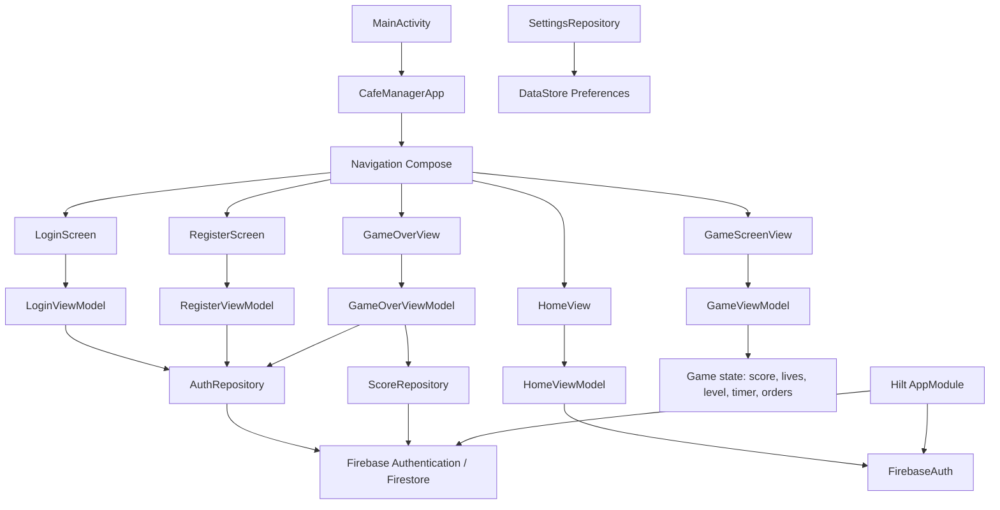
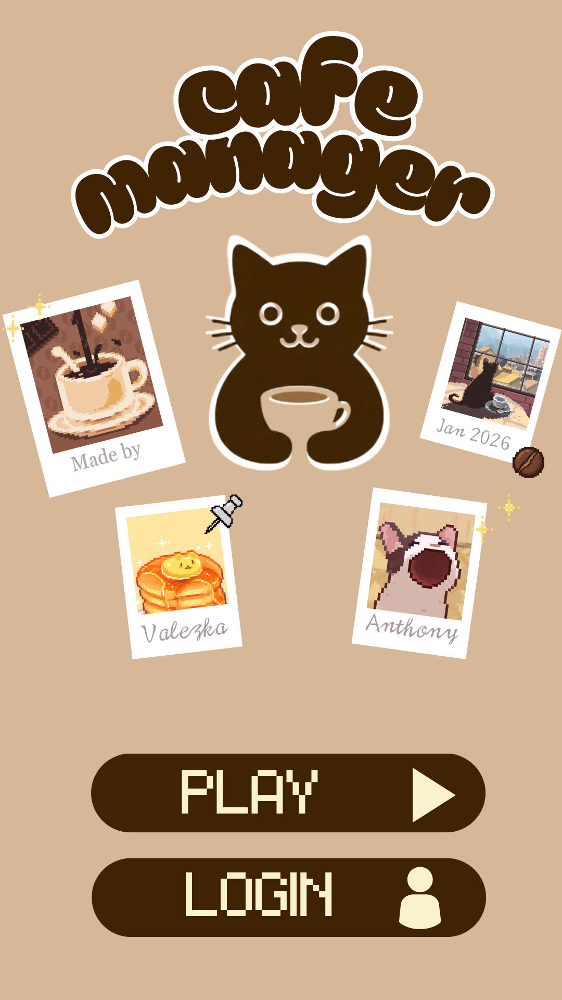
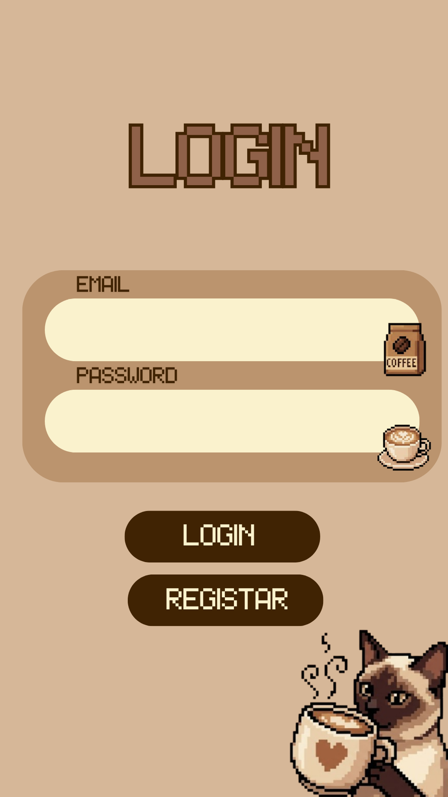
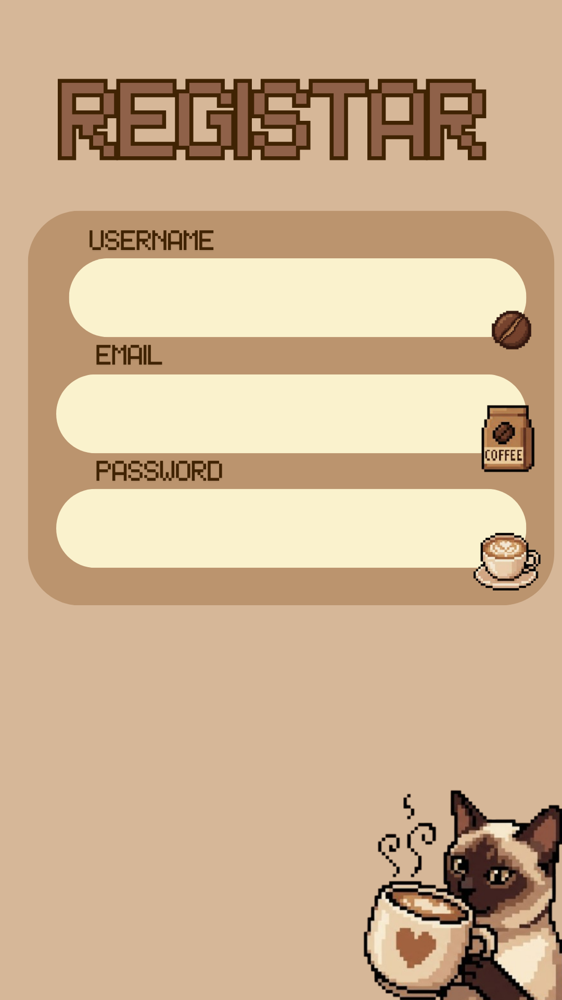
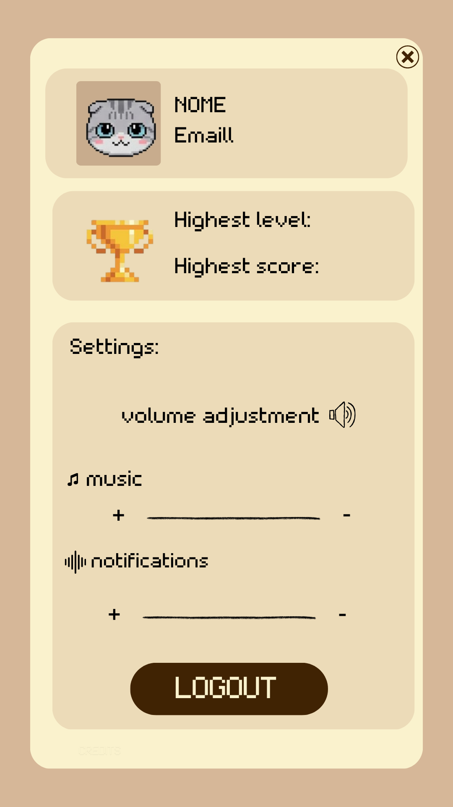
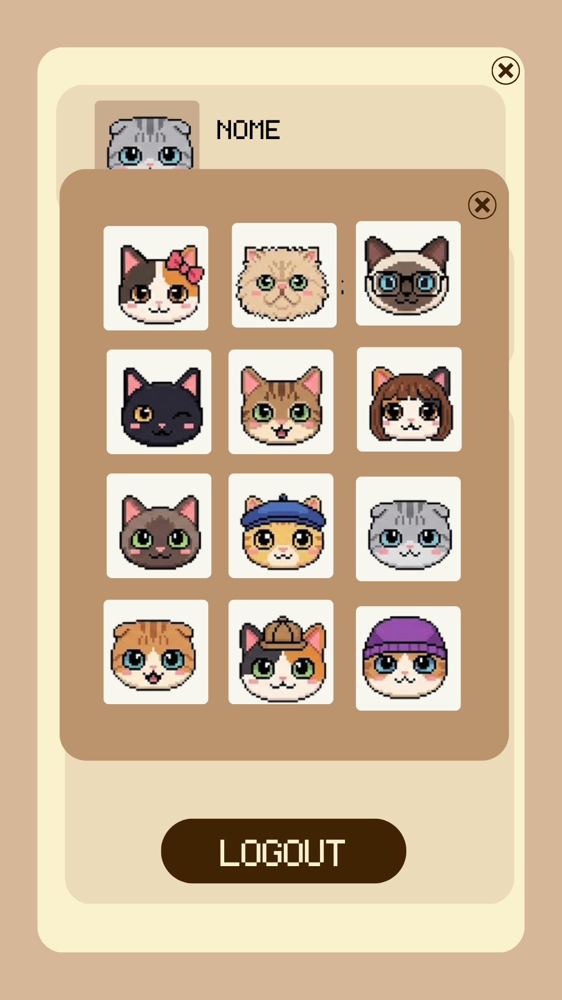
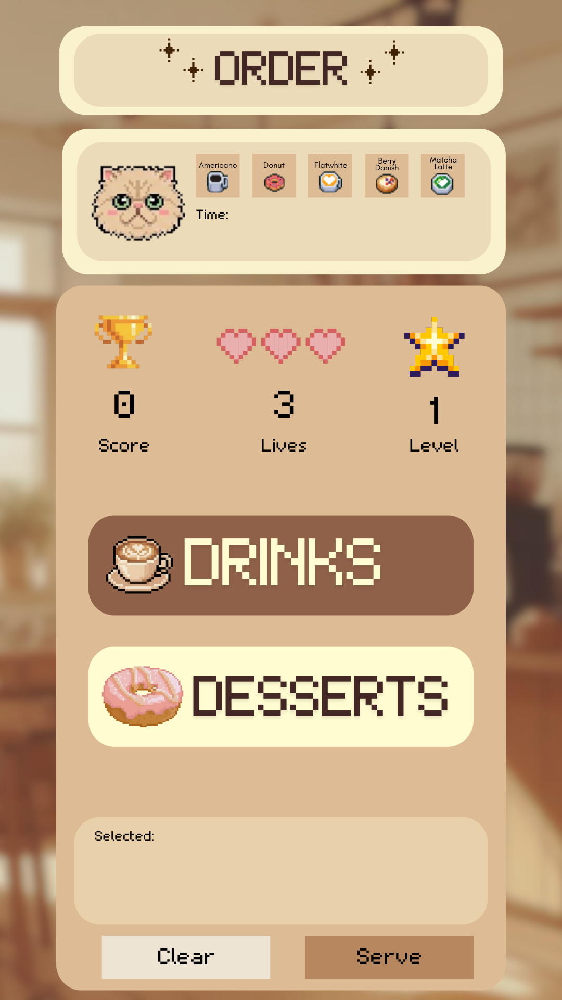

# CafeManager

A café-management simulation game for Android. The player takes orders from customers represented by cats and must assemble the requested drinks and desserts before the timer runs out.

The project combines a real-time game loop managed through Android UI state with account features, player profiles and score persistence.

**Developed by:** Anthony Frade and Valezka Naia  
**Course:** Game Development for Mobile Platforms — IPCA

## Features

### Gameplay

- Randomly generated customer orders.
- Customers represented by a selection of cat illustrations.
- A 30-second timer for each order.
- Three player lives.
- Score and level progression.
- Increasing order complexity as the player advances.
- Selection dialogs for drinks and desserts.
- Sound-volume preference stored locally.

The game data defines 18 drink items and 14 dessert items. The order size increases every three levels, up to a maximum of five requested items.

### Account and player features

- Email/password authentication through Firebase Authentication.
- User registration and profile creation.
- Player profile with highest-score and highest-level statistics.
- Score submission to Cloud Firestore.
- Home screen that adapts to the current authentication state.
- Local sound-volume settings using DataStore Preferences.

## Technology stack

| Technology | Purpose |
|---|---|
| Kotlin | Android application and game logic |
| Jetpack Compose | Declarative user interface |
| Material 3 | UI components and theming |
| Navigation Compose | Navigation between app screens |
| ViewModel | UI and game state management |
| Kotlin Coroutines / StateFlow | Asynchronous work and observable game state |
| Firebase Authentication | User sign-in and registration |
| Cloud Firestore | Player profiles and score records |
| Hilt / Dagger | Dependency injection |
| DataStore Preferences | Local settings persistence |
| Gradle Kotlin DSL | Build configuration |

## Architecture

The application separates screen rendering, state management, data access and dependency provisioning. Compose screens observe ViewModel state, while repositories encapsulate Firebase operations.



### Application and navigation

- `MainActivity.kt` is the Android entry point and launches `CafeManagerApp`.
- `MyCafeManagerApp.kt` is annotated with `@HiltAndroidApp` to initialise Hilt.
- `navigation/Routes.kt` defines the navigation destinations.
- `CafeManagerApp` configures the navigation graph for Home, Login, Register, Game and Game Over screens.

### UI and ViewModels

The UI is built with Jetpack Compose. ViewModels keep screen state and business logic outside the composable functions.

| Component | Responsibility |
|---|---|
| `HomeView` / `HomeViewModel` | Home screen and authentication-aware actions |
| `LoginScreen` / `LoginViewModel` | Login form and sign-in state |
| `RegisterScreen` / `RegisterViewModel` | Registration form and account creation |
| `GameScreenView` / `GameViewModel` | Order generation, selected items, timer, score, lives and level |
| `GameOverView` / `GameOverViewModel` | End-of-game presentation and score submission |
| `ProfileScreen` / `ProfileViewModel` | Player profile and statistics |
| `OrderSection` | Displays the current customer order |
| `SelectionDialog` | Allows the player to select menu items |
| `SelectedItemsArea` | Displays selected items |
| `StatusRow` | Displays game status information |

### Game state

`GameViewModel` exposes observable state using `StateFlow`, including:

- Score
- Lives
- Level
- Timer
- Target order
- Selected items

A coroutine controls the countdown. When the timer expires, the game applies the life-loss logic. New orders are generated from the menu data and the selected items are reset between orders.

### Data and repositories

- `AuthRepository` wraps Firebase Authentication and Firestore profile operations. It creates user profiles and updates the highest score/level when new values exceed the stored statistics.
- `ScoreRepository` writes score records to the Firestore `scores` collection and provides a query for the highest scores.
- `SettingsRepository` stores the sound volume in DataStore Preferences.
- `ResultWrapper` represents loading, success and error outcomes for repository operations.

### Dependency injection

`views/AppModule.kt` provides singleton instances of `FirebaseAuth` and `FirebaseFirestore`. Hilt injects these dependencies into the repositories and ViewModels.

## Project structure

```text
repository-root/
├── CafeManager/                  # Android Studio / Gradle project
│   ├── app/
│   │   └── src/main/java/com/example/cafemanager/
│   │       ├── game/
│   │       ├── login/
│   │       ├── models/
│   │       ├── navigation/
│   │       ├── profile/
│   │       ├── register/
│   │       ├── repositories/
│   │       ├── settings/
│   │       ├── ui/
│   │       ├── utils/
│   │       ├── views/
│   │       ├── MainActivity.kt
│   │       └── MyCafeManagerApp.kt
│   ├── build.gradle.kts
│   └── settings.gradle.kts
├── docs/
│   ├── 1.png ... 9.png
│   └── ad.png
└── README.md
```

## Screenshots

The repository includes application images in the `docs/` directory. Add or replace the images below with the clearest captures of the main menu, gameplay, login, profile and game-over screens.

| Application preview | |
|---|---|
|  |  |
|  |  |
|  |  |

## Getting started

### Requirements

- Android Studio
- Android SDK compatible with the project's Gradle configuration
- JDK compatible with the Android Gradle Plugin
- A Firebase project configured for the application

### Firebase setup

The app uses Firebase Authentication and Cloud Firestore.

1. Create or select a Firebase project.
2. Register an Android application using the package name `com.example.cafemanager`.
3. Enable the authentication provider used by the app (email and password).
4. Enable Cloud Firestore.
5. Add the Firebase Android configuration file to the app module as `app/google-services.json`.
6. Configure Firestore security rules for authenticated users. Users should only be able to access and update their own profile data, while score reads/writes should follow the intended leaderboard permissions.

Do not include Firebase service-account credentials or private server keys in the Android application. The Android client configuration file is not a substitute for Firestore security rules.

### Run the app

1. Clone the repository.
2. Open the inner `CafeManager/` directory (the one containing `settings.gradle.kts`) in Android Studio.
3. Add the Firebase configuration described above.
4. Allow Gradle to sync.
5. Run the `app` configuration on an emulator or Android device.

## Data model

The game menu uses a `GameItem` data model to represent selectable drinks and desserts. Player data is represented by models including `PlayerScore` and `UserProfile`.

## Known implementation notes

- `game/GameScreen.kt` is currently an empty placeholder; the active game screen implementation is `views/GameScreenView.kt`.
- `ScoreRepository` includes a top-scores query, but its source comments indicate that this query is not currently used in the main flow.
- The supplied project archive contains generated build output and IDE metadata. These files are not needed to build from source and should be excluded from version control.
- The README describes the implementation present in the supplied source archive; update it if the Firebase schema or gameplay flow changes.

---

*Academic Android game project developed at IPCA.*
